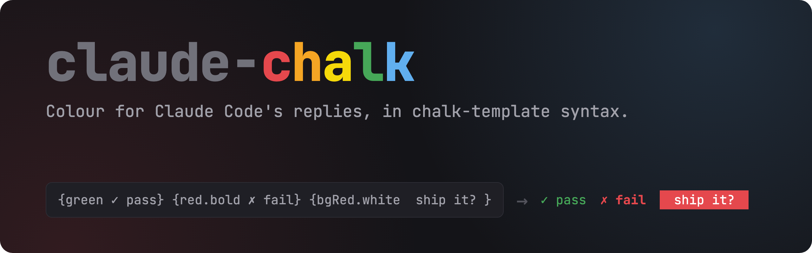
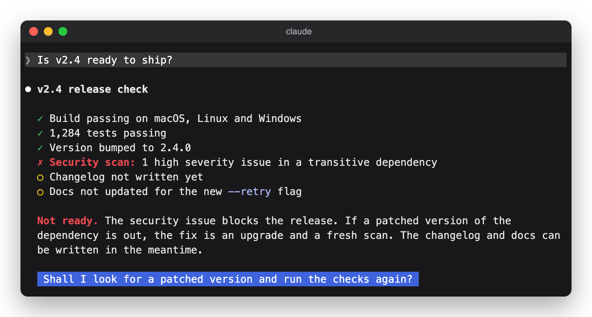
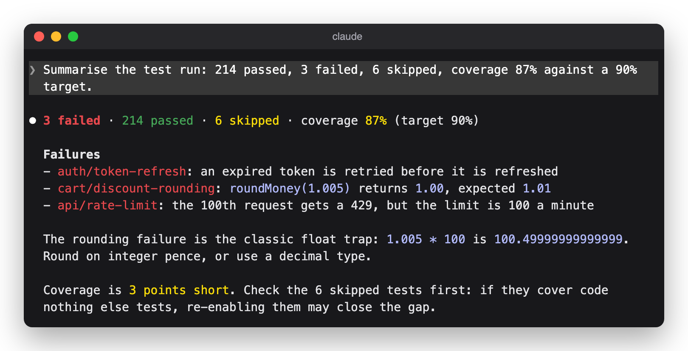
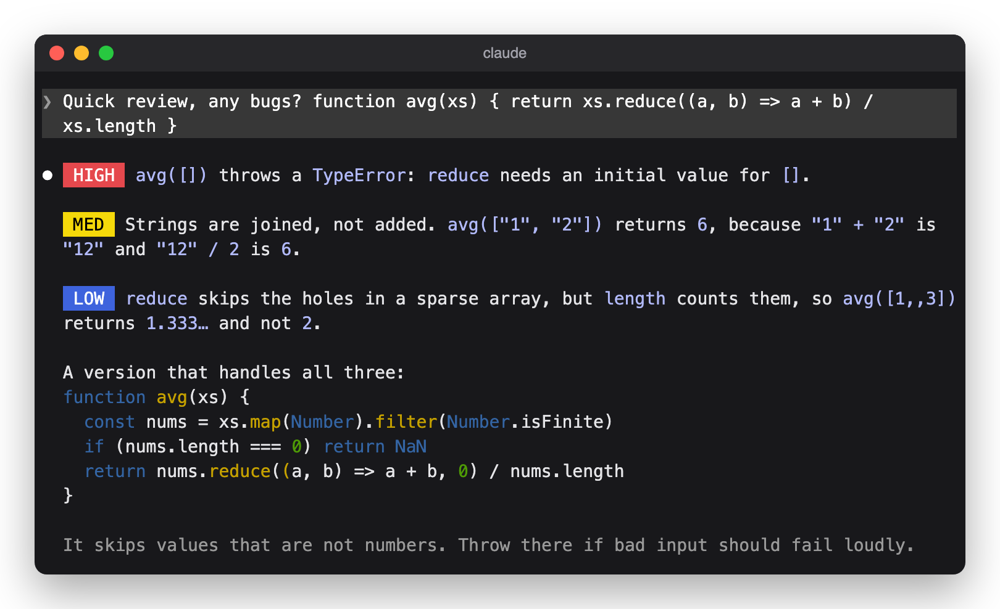
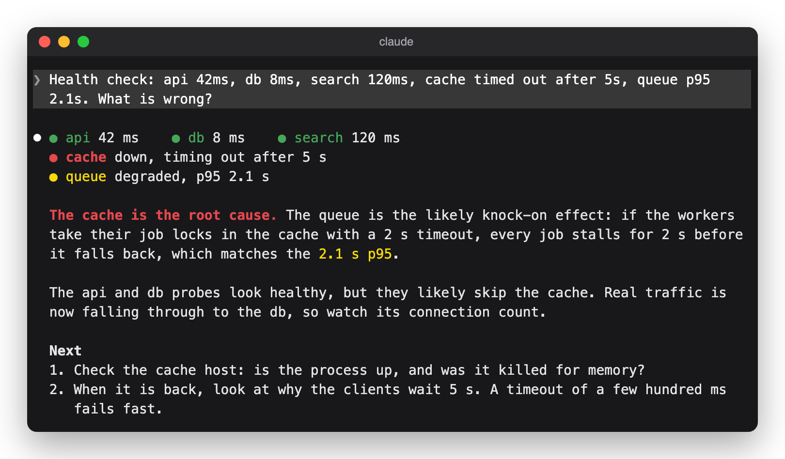
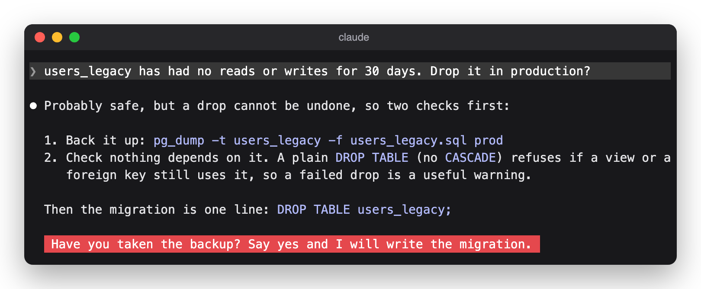
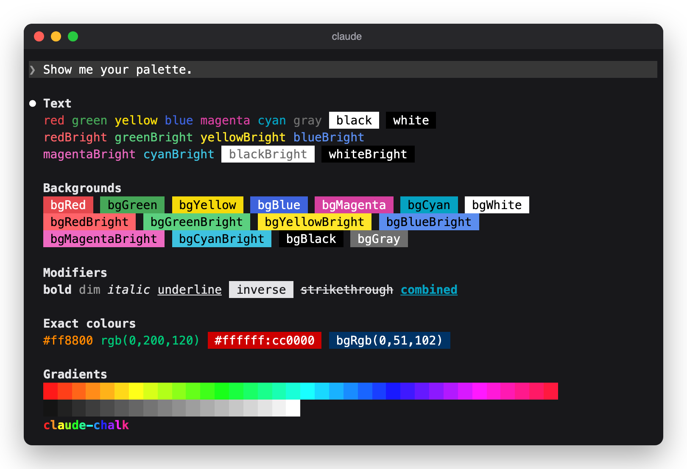

<p align="center">
  
</p>

<p align="center">
  <a href="LICENSE"></a>
  
  
  
  
</p>

<p align="center">
  <a href="#install">Install</a> ·
  <a href="#examples">Examples</a> ·
  <a href="#the-palette">Palette</a> ·
  <a href="#syntax">Syntax</a> ·
  <a href="#how-it-works">How it works</a>
</p>

**claude-chalk** is a Claude Code mod that lets Claude colour its own replies
in the terminal. Claude writes markup in the syntax of the
[chalk-template](https://github.com/chalk/chalk-template) npm package, and the
mod draws it in colour, without the braces.

Long replies can bury the one line that matters. With the mod loaded, Claude
marks failures in red, passes in green and warnings in yellow, and it puts a
question it needs answered on a coloured background. The state of things shows
at a glance, and most text stays plain.

<p align="center">
  
</p>

## Install

At the prompt of a Claude Code session in a terminal:

```text
/plugin install chalk --marketplace adamkdean/claude-chalk
```

Answer `y` to add the marketplace, then choose a scope. The mod is active in
that session at once and, under the user scope, in every session after it.

From a shell:

```sh
claude plugin install chalk --marketplace adamkdean/claude-chalk
```

In the desktop app, where `/plugin` does not run: click **+** next to the
prompt box, then **Plugins**, **Add marketplace** with
`adamkdean/claude-chalk`, then **Add plugin**.

The plugin is named `chalk`, after the npm package whose syntax it uses.
Claude Code reserves plugin names that start with `claude-`.

## Examples

The replies in these screenshots are scripted to show what the mod can do. Each
one is played back through a live Claude Code session with the mod loaded, so
every image shows exactly how the mod draws it.

### Test runs

Failures stand out from passes, and the coverage gap is easy to spot.

<p align="center">
  
</p>

### Code review

Each finding carries its severity on a coloured background.

<p align="center">
  
</p>

### Incidents

Service status reads at a glance, and the root cause is in red ahead of the
detail.

<p align="center">
  
</p>

### Questions that need an answer

When Claude cannot go on without a decision, the question goes on its own line
on a background colour: blue for an ordinary question, red when the answer
allows something risky or hard to undo.

<p align="center">
  
</p>

## The palette

Every style the mod draws.

<p align="center">
  
</p>

## Syntax

A block is `{style text}`: an opening brace, a style, one space, the text and a
closing brace. Chain styles with dots. Blocks nest, and an inner block adds to
the styles around it.

| Kind | Styles |
| --- | --- |
| Colours | `black` `red` `green` `yellow` `blue` `magenta` `cyan` `white` `gray`, and each of the first eight with `Bright` (`redBright`) |
| Backgrounds | `bg` and a colour: `bgRed`, `bgBlueBright` |
| Modifiers | `bold` `dim` `italic` `underline` `inverse` `strikethrough` |
| Hex | `#ff8800` (text), `#:003366` (background), `#ffffff:cc0000` (both), `hex(#ff8800)`, `bgHex(#003366)` |
| RGB | `rgb(255,136,0)`, `bgRgb(0,51,102)`, with no spaces |

```text
{green ✓ All 42 tests pass}
{red.bold Build failed} in `src/parser.ts`
{yellow Warning:} the cache is stale.
{bold Hello {red world}}
{#ff8800:001122.bold Hot}
{bgRed.whiteBright  Delete these 3 files? }
```

Inside a block, write `\{` and `\}` for literal braces. Text in braces that is
not a valid style, such as `{name}`, is left as written.

## How it works

The mod has two hooks:

- `prompt.compose` adds a short section to the system prompt that teaches
  Claude the syntax and when to use it. Headless runs (`claude -p`) do not get
  it, because nothing draws the colours there.
- `ui.render` on `AssistantMessage` redraws each reply block that holds markup.
  A paragraph with markup is drawn as coloured text, and every other paragraph
  is drawn as markdown, as before. A block without markup is left to Claude
  Code.

Named colours are drawn as Claude Code draws those names. Hex and RGB colours
are drawn exactly. Only the drawing changes: the transcript keeps the markup as
Claude wrote it.

## Limits

- Markup is drawn in prose only. Inside code spans and code blocks it is shown
  as written.
- A block ends at the end of its paragraph.
- In a paragraph with markup, bold, italic, inline code, headings and lists
  are drawn, but tables are shown as plain text.
- Where the mod is not loaded, the markup is shown as written.
- The mod API is in early access and can change between Claude Code releases.
  Tested with Claude Code 2.1.312.

## Development

```sh
claude --plugin-dir .      # start a session with the mod loaded from this folder
claude plugin validate .   # check the manifests and the hooks module
claude plugin test .       # run the tests in tests/
```

[AGENTS.md](AGENTS.md) describes the layout, the checks and the rules for
changes, including how to check drawing in a real terminal.

The screenshots play scripted replies through a live session in a
pseudo-terminal, record the output, and replay it into
[xterm.js](https://xtermjs.org) to render it.

## Legal

Released under the [MIT licence](LICENSE).

An independent project, not made by or affiliated with Anthropic or the chalk
project.
